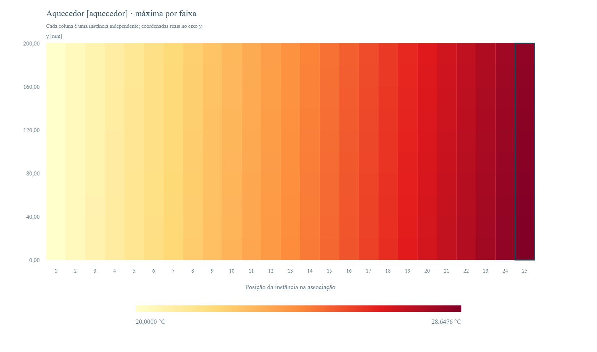

# Método Nodal em Python

Ferramenta em Python para montar e resolver redes térmicas com condução, convecção, radiação e transporte entálpico de fluido. Inclui editor visual de regiões retangulares, montagem automática da malha 2D, associação de componentes reutilizáveis e um núcleo para regime permanente e transiente.

A versão atual é a branch padrão [`codex/revisao-reproducao`](https://github.com/OAfundador/nodal-method/tree/codex/revisao-reproducao). A implementação anterior está preservada em [`legado`](https://github.com/OAfundador/nodal-method/tree/legado).

Baseado em **Transferência de Calor Computacional — Método Nodal** (J. L. Ferraz Bastos & D. A. de Andrade, IPEN/CNEN-SP).

---

## Editor visual local

Instale as dependências uma vez:

```bash
python -m pip install -r requirements.txt
```

No Windows, abra **`iniciar_visual.bat`**, ou execute:

```bash
python app_visual.py
```

O navegador abre em `http://127.0.0.1:8765`. Mantenha o terminal aberto enquanto usa a ferramenta. Os cálculos usam o solver Python deste repositório; a interface não depende de serviços externos, CDNs ou publicação.

1. Em **Materiais**, cadastre nome, fase e propriedades. Para condução estacionária, `k` é obrigatório; `rho`, `cp` e `mu` são opcionais. Também é possível informar os coeficientes de `k(T)`.
2. Selecione um material e use **Retângulo**: clique e arraste para desenhar. Também pode arrastar um cartão de material para a área de desenho. Use **Selecionar** para mover; os quatro cantos permitem redimensionar. O painel à direita aceita coordenadas e dimensões exatas.
3. Encoste as regiões, sem sobreposição. **Encaixar bordas e grade** dá prioridade às bordas das regiões vizinhas ao desenhar, mover ou arrastar os cantos. Se restar uma folga, selecione o retângulo e clique em **Esticar até a região vizinha** no painel da direita; escolha a borda ou deixe a vizinha mais próxima. A ação altera uma única borda e pode ser desfeita com `Ctrl+Z`. Defina a geração de calor de cada região, se houver.
4. Em **Contornos**, configure temperatura, convecção, radiação, convecção + radiação, fluxo imposto ou isolamento nas faces externas do domínio. Para radiação, informe emissividade, fator de vista e temperatura radiativa; no caso combinado, informe também h e a temperatura do fluido. Em **Malha**, escolha `nx` e `ny` e clique em **Gerar malha**. As faces verdes indicam o contato entre regiões.
5. Clique em **Resolver modelo** para obter o mapa, os perfis e os resultados por região. **Exportar CSV** salva as temperaturas dos nós das células; **Salvar imagem** exporta o desenho ou campo em PNG. **Salvar modelo** e **Abrir modelo** preservam/restauram os dados em JSON. **Exportar .txt** salva comandos executáveis pelo REPL.

A interface mostra comprimentos em **mm**, temperaturas em **°C** e propriedades em SI. O JSON e o núcleo numérico usam comprimentos em **m**. Áreas vazias são omitidas e suas bordas internas são isoladas; os contornos configuráveis pertencem às faces externas do domínio. O editor calcula regime permanente, com até 900 células e 1600 incógnitas. Uma região desconectada de qualquer referência térmica é rejeitada.

**Adaptar a malha às interfaces**, na aba Malha, cria passos variáveis que preservam as dimensões dos retângulos e as camadas finas. As divisões pedidas são mantidas quando possível, com pelo menos uma célula em cada intervalo entre interfaces. Uma folga geométrica continua sendo um vazio isolado; use o botão de esticar para fechar a folga. No REPL, `mesh ... fix=interfaces` usa a mesma opção. O modo antigo `fix=snap` aproxima a geometria à grade uniforme e altera suas dimensões.

Para regiões fluidas com propriedades constantes, informe `cp`, vazão **mássica**, direção e temperatura de entrada no painel da região. Na interface sólido-fluido, informe também `h` interno na aba Malha. A vazão é distribuída entre as cadeias paralelas proporcionalmente à área da seção. O painel também permite restringir a condução dos sólidos a `x` ou `y`; o padrão é condução em ambas as direções.

Para **água com propriedades variáveis**, instale a dependência opcional:

```bash
python -m pip install -r requirements-agua.txt
```

Selecione **Água líquida · IAPWS97** no material e **Água · IAPWS97 variável** no escoamento da região. Informe vazão volumétrica, pressões de entrada/saída, direção e temperatura de entrada. Para calcular `h`, selecione **Dittus–Boelter · aquecimento** e informe o diâmetro hidráulico. A pressão varia linearmente; a vazão volumétrica é constante; `ρ` e `cp` são avaliados a montante de cada intervalo, e `h` na temperatura local do fluido. Os nós fluidos representam a saída de cada intervalo axial. É uma marcha em temperatura; uma formulação com vazão mássica constante ou integração de entalpia define outro modelo. O programa não calcula a queda de pressão. O uso da correlação deve corresponder às hipóteses do caso definido.

O material **U3Si2-Al** disponibiliza a correlação `k(T)` já existente na biblioteca do terminal. As correlações selecionadas prevalecem sobre os valores constantes. O editor continua calculando regime permanente; a evolução física no tempo é executada por `solve_transient` no núcleo/terminal.

Para verificar ou executar o mesmo modelo nos três modos, exporte `.txt` pelo editor. Execute `python exemplos/nodal_repl.py modelo_nodal.txt --csv temperaturas.csv`, ou abra `python exemplos/nodal_repl.py` e digite os mesmos comandos. A suíte compara o campo inteiro, as fontes e a rede após passar pelos parsers de cada modo, incluindo água variável quando a dependência opcional está instalada.

O menu oferece **parede uniforme**, **parede composta**, a **geometria 2D do chip** e o **NAFEMS T4** com ponto de avaliação na superfície. O botão **Benchmarks** executa os quatro casos do livro, os casos públicos NAFEMS/TMAP8 e a placa com geração, convecção e radiação de Onur & Sivrioglu, descritos em [BENCHMARKS.md](BENCHMARKS.md). As equações desse artigo foram verificadas, mas há divergências com alguns patamares de seus gráficos. Atalhos: `V` seleciona, `R` desenha, `Del` exclui a região selecionada e `Ctrl+Z` desfaz uma alteração. A ferramenta também permite apagar ou redimensionar uma região pelo painel de propriedades.

Se a porta estiver ocupada, use `python app_visual.py --porta 8766`. Para iniciar sem abrir o navegador, acrescente `--sem-abrir`.

## Associar componentes: de um canal a um conjunto de 25

Um **componente** é um modelo individual completo: geometria, materiais, malha, fontes, contornos e escoamento. Uma **instância** reutiliza esse componente dentro de uma associação. Assim, você pode definir um canal uma vez e criar 25 instâncias, ou reunir modelos de canais diferentes na mesma saída.

As instâncias desta associação são **independentes**, como em uma comparação de canais calculados separadamente. Elas não compartilham calor, pressão ou vazão automaticamente. Para representar uma placa que troca calor com dois canais, por exemplo, desenhe os três objetos em um mesmo componente e defina seus contatos; depois reutilize esse componente na associação.

### Pelo desenho

1. Monte ou abra seu modelo no editor. Pode ser uma parede, um canal com aquecedor ou um conjunto de combustível, revestimento e água. Os materiais e o escoamento ficam definidos nesse modelo individual.
2. Clique em **Associar componentes**, no cabeçalho. Uma nova aba recebe o modelo atual na biblioteca. Também pode abrir `http://127.0.0.1:8765/assembly` e usar **Importar JSON** para adicionar um ou mais modelos salvos.
3. Selecione o componente, informe a quantidade — por exemplo, **25** — e clique em **Adicionar instâncias**. Cada linha permite escolher componente, nome e fator de geração. Você pode usar vários componentes no mesmo conjunto.
4. Para informar os fatores em lote, abra **Fatores de geração diferentes em cada instância** antes de adicionar as instâncias. Digite um valor por instância, separado por espaço ou ponto e vírgula, com ponto decimal. Uma lista vazia usa fator 1 em todas.
5. Clique em **Calcular associação**. Escolha a região do mapa, o eixo e a unidade. Clique em uma coluna ou use o seletor para consultar os perfis e a tabela daquela instância.
6. Use **Salvar JSON** ou **Exportar .txt** para guardar a definição completa. **CSV**, **Imagem PNG** e **Relatório HTML** salvam as saídas. O HTML inclui os dados e os gráficos e pode ser aberto sem servidor.

Para experimentar imediatamente, clique em **Abrir exemplo de 25 canais** e depois em **Calcular associação**. O exemplo usa um aquecedor e um canal de água com dados sintéticos, publicados em [JSON](exemplos/associacao_25_canais.json) e [TXT](exemplos/associacao_25_canais.txt).

Na biblioteca, **Editar no desenho** abre o componente em outra aba. Faça as alterações e clique em **Atualizar associação** nessa aba: todas as instâncias que referenciam o componente passam a usar a nova definição. Resolva o conjunto novamente. Para criar uma variante, use **Duplicar** e atribua a cópia às instâncias desejadas. **Desfazer** recupera a definição anterior; um componente em uso só pode ser excluído depois de remover suas instâncias.

O **fator de geração** multiplica somente as fontes volumétricas de todas as regiões da instância. Fator 1 mantém a geração original; 0 a desliga; 2 a duplica. Os materiais, contornos, coeficientes de troca e vazões permanecem os do componente. Para mudar esses dados em apenas alguns canais, crie outro componente e selecione-o nas linhas correspondentes. Correlações registradas de propriedades e de convecção são reavaliadas durante cada solução.

### Por comandos ou arquivo `.txt`

Execute o exemplo incluído, a partir da raiz do repositório:

```bash
python exemplos/nodal_repl.py exemplos/associacao_25_canais.txt --csv saidas/associacao/temperaturas.csv
```

O arquivo faz a associação com estes comandos:

```text
component_load canal file=componentes/canal_aquecido.json
assembly "Associação didática de 25 canais"
assembly_view axis=y region=aquecedor unit=C offset_m=0
for i=1..25
    associate canal_$i component=canal source_factor=$((i-1)/12) name="Canal $i"
end
solve_assembly
```

Os fatores `(i-1)/12` vão de 0 a 2 e servem apenas para demonstrar o recurso. Substitua-os pelos valores do seu caso. O caminho de `component_load` é relativo à pasta do `.txt` que está sendo executado. No prompt interativo, ele é relativo à pasta onde você iniciou o programa; nesse caso, use `file=exemplos/componentes/canal_aquecido.json`.

Ao definir materiais por comandos, `property_model=constant` usa as propriedades que você informou, sem herdar correlações de um material predefinido com o mesmo nome. Sem `property_model` explícito, continua valendo a sobreposição histórica dos campos sobre a biblioteca do REPL.

Se a geometria já está definida no terminal, depois de `mesh` e `build_from_geom` use `component_save canal` para cadastrá-la na biblioteca da sessão. Para aproveitar um arquivo existente, `component_load` aceita o JSON do editor ou um `.txt` com geometria compatível; ao importar o `.txt`, seus comandos de solução e exportação são omitidos. Depois de cadastrar seus componentes, use `assembly`, `associate` e `solve_assembly` como no exemplo. `assembly` inicia um conjunto novo e preserva os componentes cadastrados; `assembly_reset` limpa a biblioteca e o conjunto.

Após resolver, estes comandos salvam os dados e o relatório:

```text
export csv=saidas/associacao/temperaturas.csv
assembly_save file=saidas/associacao/conjunto.json
assembly_save file=saidas/associacao/conjunto.txt
assembly_report file=saidas/associacao/relatorio.html
```

Para reabrir pelo terminal:

```text
assembly_load file=saidas/associacao/conjunto.json
solve_assembly
```

Os arquivos salvos por `assembly_save` incorporam os componentes e não dependem dos arquivos originais. O `.txt` portátil também pode ser executado com `python exemplos/nodal_repl.py conjunto.txt` ou aberto em **Abrir associação** na interface. Esse importador visual lê somente o formato portátil exportado pela ferramenta; arquivos gerais com loops ou `component_load` devem ser executados no terminal e então salvos como associação portátil.

### Diretamente em Python

O mesmo modelo e o mesmo solver são usados nos três modos. Este exemplo completo, executado na raiz do repositório, cria e resolve a associação:

```python
import json
from pathlib import Path
from associacao import ModelAssembly
from visual.relatorio_associacao import export_report

modelo = json.loads(Path("exemplos/componentes/canal_aquecido.json").read_text(encoding="utf-8"))
conjunto = ModelAssembly(name="Associação didática de 25 canais")
conjunto.add_component("canal", modelo)
for i in range(1, 26):
    conjunto.associate(f"canal_{i}", "canal",
                       source_factor=(i - 1) / 12, name=f"Canal {i}")
conjunto.set_view({"axis": "y", "region": "aquecedor", "unit": "C"})
resultado = conjunto.solve()
conjunto.export_csv("saidas/associacao/temperaturas.csv")
export_report(conjunto, "saidas/associacao/relatorio.html")
print(resultado["maximum_C"])
```

O script [associar_componentes.py](exemplos/associar_componentes.py) executa esse fluxo e também grava os arquivos JSON e TXT:

```bash
python exemplos/associar_componentes.py --saida saidas/associacao
```

### O que conferir no exemplo

O componente [canal_aquecido.json](exemplos/componentes/canal_aquecido.json) também está disponível em [comandos TXT](exemplos/componentes/canal_aquecido.txt) e no menu do desenho como **Canal aquecido · balanço exato**. Há 10 intervalos axiais, geração uniforme, propriedades constantes e entrada a 20 °C. A geração total do aquecedor é 8 W para fator 1; a vazão é 0,01 kg/s e `cp = 4200 J/(kg·K)`. Sem perdas externas, a temperatura de saída deve satisfazer `T_saida = 20 + 8 × fator / (0,01 × 4200)`.

| Instância | Fator | Potência [W] | Água na saída [°C] | Máxima no aquecedor [°C] |
| --- | ---: | ---: | ---: | ---: |
| Canal 1 | 0 | 0 | 20,000000 | 20,000000 |
| Canal 13 | 1 | 8 | 20,190476 | 24,323810 |
| Canal 25 | 2 | 16 | 20,380952 | 28,647619 |



Este exemplo é uma verificação didática por balanço de energia. Seus parâmetros e fatores são sintéticos e não representam os dados de entrada do caso local da placa de reator. Os benchmarks de literatura continuam documentados em [BENCHMARKS.md](BENCHMARKS.md).

No mapa do conjunto, cada coluna representa uma instância na ordem da lista. Cada faixa mostra a **maior temperatura das células** da região selecionada naquele intervalo do eixo; o perfil por região usa o mesmo critério. O mapa é uma comparação das instâncias, não a planta geométrica de um núcleo. O deslocamento da origem apenas ajusta os rótulos do eixo. O CSV conserva todas as células, com identificador da instância, componente, fator, região, material, índices, coordenadas em metros e temperaturas em °C/K. Para temperaturas de faces, consulte a solução individual retornada pela API Python.

A associação aceita até **50 componentes, 100 instâncias e 20.000 células de domínio somadas**, mantendo os limites de 900 células e 1600 incógnitas por modelo individual. A definição enviada à interface deve ter até 1 MB. Ela usa o formato geométrico do editor: fontes volumétricas constantes por região, propriedades constantes, `k(T)` polinomial ou correlações registradas. Redes montadas diretamente com `node`/`link`, funções arbitrárias, tabelas de propriedades e fontes espaciais continuam disponíveis no núcleo/REPL; não são convertidas automaticamente para esse formato. Uma construção incompatível é recusada com mensagem de erro.

## Executar os benchmarks e testes

```bash
python -m pip install -r requirements.txt
python validacao_livro.py
python validacao_online.py
python validacao_onur.py
python -m unittest discover -s tests -v
```

Os benchmarks verificam os balanços e a redução do erro ao refinar a malha ou o passo de tempo. A suíte também cobre os exemplos antigos, entradas inválidas, exportação, API local e associação de componentes. Para a associação, compara todas as células entre Python, JSON, comandos interativos e TXT, verifica o balanço dos 25 canais e confere que a biblioteca original é preservada.

`validacao_onur.py` gera `saidas_comparacao/onur.html`, curvas e históricos adimensionais das duas faces, com os parâmetros das figuras 2 e 5 de Onur & Sivrioglu (1993). Também é possível gerar o relatório pelo botão **Benchmarks** do editor. A análise explicita diferenças entre as equações e a figura 8, sem ajustar parâmetros para forçar uma reprodução.

## Exemplo de saída: placa de reator

Resultados calculados pela rede nodal para um caso local com 51 pontos axiais, no canal 14. A saída corresponde ao plano z=−0,300 m.

| Perfil de geração | Máxima no combustível [K] | Fluido na saída [°C] | Combustível na saída [°C] |
| --- | ---: | ---: | ---: |
| Cossenoidal | 359,3492 | 45,0149 | 45,0149 |
| Constante | 347,5215 | 45,0200 | 74,3715 |

O [CSV dos resultados](resultados/placa_reator.csv) inclui as máximas e as temperaturas de saída dos quatro componentes. Os arquivos de entrada desse caso permanecem locais. A tabela registra a saída calculada sob as hipóteses desse modelo; as verificações reproduzíveis com os dados publicados estão em [BENCHMARKS.md](BENCHMARKS.md).

## Melhorias desta versão

- Editor com cadastro de materiais, desenho, movimento e redimensionamento de regiões, malha conectada e mapa de temperaturas.
- Biblioteca de componentes reutilizáveis e associações de instâncias independentes pelo desenho, comandos, TXT e Python, com mapa do conjunto, perfis, CSV e relatório HTML portátil.
- Contornos de temperatura, fluxo, isolamento, convecção, radiação e convecção + radiação na mesma superfície.
- Execução de arquivos organizada em `CaseRunner`, com mensagens de erro por linha e exportação CSV.
- Opções de tolerância e iteração do REPL aplicadas ao solver; convergência conferida pelo resíduo do balanço.
- Transiente com último passo ajustado ao tempo final, tratamento do arredondamento decimal e capacitâncias reavaliadas durante a solução.
- Testes de regressão, balanço de energia e refinamento contra soluções analíticas e referências públicas.

---

## Filosofia

O REPL (`nodal_repl.py`) é **100% genérico** — não conhece nenhum domínio físico específico. O que resolver e como montar a rede é definido exclusivamente pelo arquivo `.txt` passado como argumento, usando as ferramentas genéricas do método nodal: materiais, nós, links, geometria 2D.

---

## Como usar

### 1. Instalar

```bash
git clone https://github.com/OAfundador/nodal-method.git
cd nodal-method
pip install -r requirements.txt
```

### 2. Rodar um caso pronto

```bash
# Chip eletrônico — validado contra o livro
python exemplos/nodal_repl.py exemplos/interativo_chip.txt

# Canal de refrigeração com transporte entálpico
python exemplos/nodal_repl.py exemplos/comandos_canal.txt

# Dois canais acoplados por placa combustível
python exemplos/nodal_repl.py exemplos/comandos_canal_acoplado.txt

# Troca de calor em tubo cilíndrico
python exemplos/nodal_repl.py exemplos/comandos_tubo.txt

# Projeto Final TNR5703 — referência
python exemplos/nodal_repl.py exemplos/interativo_projeto_final.txt
```

Use `--quiet` para reduzir a saída, `--csv arquivo.csv` para exportar os nós e `--listar` para listar os exemplos. Erros em arquivos interrompem a execução, com nome do arquivo e número da linha, e retornam código de saída diferente de zero.

### 3. Modo interativo (prompt `>>>`)

```bash
python exemplos/nodal_repl.py
```

Digite comandos diretamente e resolva qualquer problema passo a passo:

```
>>> material aluminio k=205 rho=2700 cp=900
>>> node T1 diffusion Q=100 V=1e-4
>>> node T2 boundary T_fixed=20
>>> link T1 T2 cond G=2.5
>>> solve
  convergiu=True, |R|=3.2e-11, iter=1
  T1 = 60.00 C
  T2 = 20.00 C
>>> viz png=minha_rede.png
```

---

## Arquivos disponíveis

| Arquivo | Problema | Comandos-chave |
|---|---|---|
| `interativo_chip.txt` | Chip eletrônico Q=4W — validado contra o livro | `domain`, `region`, `source`, `bc`, `mesh`, `build_from_geom` |
| `interativo_projeto_final.txt` | Projeto Final TNR5703 — núcleo completo | `material`, `node`, `link`, `for..end`, `solve` |
| `comandos_canal.txt` | Canal aquecido com transporte entálpico | `fluid_chain`, `node`, `link` |
| `comandos_canal_acoplado.txt` | Dois canais acoplados por placa combustível | `node`, `link`, `fluid_chain` |
| `comandos_tubo.txt` | Troca de calor em tubo cilíndrico | `node`, `link`, `g_cond`, `g_conv` |
| `associacao_25_canais.txt` | 25 instâncias de um canal aquecido, dados sintéticos | `component_load`, `assembly`, `associate`, `solve_assembly` |
| `componentes/canal_aquecido.txt` | Componente individual com balanço de energia analítico | `domain`, `region`, `flow_region`, `build_from_geom` |

---

## Módulos principais

| Módulo | Papel |
|---|---|
| `materiais.py` | `Material` com `k(T)`, `cp(T)`, `ρ(T)`, `μ(T)` — constante, polinômio ou expressão simbólica |
| `geometria.py` | `Geometry2D` — domínio retangular com regiões, fontes, BCs e malha |
| `condutancias.py` | `conduction_G`, `convection_G`, série/paralelo |
| `nos.py` | `NodalNetwork` — monta o resíduo `R(T)` e gerencia os links |
| `solver.py` | `solve_steady_state` — Newton-FD com fallback `scipy.optimize.root` |
| `associacao.py` | `ModelAssembly` — biblioteca, instâncias, validação, solução e formatos portáteis |
| `visual/` | Modelo validado, servidor local e interface do editor |
| `app_visual.py` | Inicia o editor no navegador |
| `validacao_*.py` | Casos de referência e geração dos relatórios |

### Uso direto via Python

```python
from nos import NodalNetwork, NodeKind, TransferKind
from solver import solve_steady_state

net = NodalNetwork()
Tc = net.add_node("Tc", NodeKind.DIFFUSION, x=0, y=0, volume=1e-6, source=4.0)
Tp = net.add_node("Tp", NodeKind.BOUNDARY, x=1, y=0, fixed_temperature=44.0)
net.add_link(Tc, Tp, TransferKind.CONDUCTION, conductance=0.17908)

result = solve_steady_state(net, tol=1e-10)
print(net.nodes[Tc].temperature)  # → 66.34 °C
```

---

## Referência de comandos do REPL

### Materiais

```
material <nome> [phase=solid|fluid] [k=v] [rho=v] [cp=v] [mu=v]
                [k_poly=a0,a1,a2]       # k(T) = a0 + a1·T + a2·T²
                [k_expr="15+0.002*T"]   # expressão simbólica em T [°C]
materiais                               # lista todos os materiais
```

Quando `k_poly` ou `k_expr` são fornecidos, a condutância é reavaliada a cada iteração Newton com a temperatura local — sem nenhuma alteração no solver.

### Geometria 2D (montagem automática da rede)

```
domain W=v H=v
region <nome> [mat=<material> | k=v] x0=v x1=v y0=v y1=v
source <regiao> q=v                      # fonte volumétrica [W/m³]
bc <face> <tipo> [T=v] [h=v] [T_inf=v]  # face: top/bottom/left/right
mesh nx=v ny=v [fix=auto]
show_geom
build_from_geom [tz=v]
```

### Rede nodal direta

```
node <nome> <tipo> [Q=v] [T_fixed=v] [T_init=v] [V=v]
     tipos: diffusion | arithmetic | fluid | boundary
link <a> <b> <tipo> G=v [dir=fwd|bwd|undirected]
     tipos: cond | conv | fluid | rad
fluid_chain n1 n2 [n3...] mdot=v cp=v [T_in=v]
show
solve
solve tol=1e-8 max_iter=500 linhas=20
export csv=temperaturas.csv
reset / reset_net
```

### Condutâncias prontas

```
g_cond k=v A=v L=v     →  G = k·A/L  [W/K]
g_conv h=v A=v          →  G = h·A    [W/K]
```

### Variáveis e loops

```
let <nome> = <expressao>
for <var>=<lo>..<hi>
  ...                    # use $var e $(expr) nas linhas
end
```

### Expressões dinâmicas

Em qualquer campo `G_expr="..."` ou `Q_expr="..."`:

```
dittus_h(material, T, P, mdot, A_flow, Dh)   # Dittus-Boelter h [W/m²K]
conduction_G(k, A, L)
convection_G(h, A)
sum_over("i", lo, hi, "expr")
math.*                                         # sin, exp, log, etc.
T['nome_no']                                   # temperatura atual do nó
```

### Visualização

```
viz  [png=arquivo.png] [titulo=Texto]
gif  [gif=arquivo.gif] [fps=10] [steps=40] [dpi=100]
```

---

## Validação — Chip eletrônico

Componente de Q = 4 W sobre substrato de cobre. Três casos do Capítulo V do livro:

| Caso | Livro | Este código |
|---|---|---|
| (a) só condução, modelo concentrado | 66,3 °C | **66,3375 °C** |
| (b) + convecção h=30 W/m²K | 60,3 °C | **60,2663 °C** |
| (e) + radiação | 59,1 °C | **59,0782 °C** |

Esses valores usam a rede concentrada do exercício 1 do livro. O arquivo `interativo_chip.txt` e o exemplo visual distribuem a geração em uma geometria 2D e resultam em **66,4854 °C**: não são a mesma discretização do modelo concentrado. O quarto benchmark do livro é a esfera em resfriamento (exercício 2), comparada à solução exponencial exata e com refinamento temporal.

---

## Estrutura do repositório

```
nodal-method/
├── app_visual.py                      ← abre o editor visual
├── iniciar_visual.bat                 ← atalho para Windows
├── condutancias.py
├── geometria.py
├── materiais.py
├── nos.py
├── solver.py
├── requirements.txt
├── BENCHMARKS.md                      ← fontes, resultados e critérios
├── validacao_livro.py
├── validacao_online.py
├── validacao_onur.py
├── visual/                            ← interface e API local
├── tests/                             ← suíte de testes
├── resultados/                        ← exemplos de saídas calculadas
└── exemplos/
    ├── nodal_repl.py                   ← REPL genérico — ponto de entrada
    ├── interativo_chip.txt             ← chip eletrônico (validado)
    ├── interativo_projeto_final.txt    ← Projeto Final TNR5703 (referência)
    ├── comandos_canal.txt              ← canal aquecido
    ├── comandos_canal_acoplado.txt     ← dois canais acoplados
    └── comandos_tubo.txt               ← troca de calor em tubo
```

> As pastas `saidas*/` são geradas localmente e não são rastreadas pelo git.

---

## Stack

`numpy`, `scipy`, `matplotlib`, `pillow`. Python 3.9+.

O editor e os exemplos geométricos usam regime estacionário. A API `solve_transient` e o comando `solve_transient` do REPL também oferecem Euler implícito, com capacitâncias reavaliadas durante o cálculo.

---

## Sobre

Desenvolvido como material de estudo da disciplina **TNR5703 — Análise Termo-fluido-dinâmica de Reatores Nucleares** (PPGEN/USP), com apoio de IA e revisão manual contra o livro de referência e os enunciados da disciplina.

Se usar este código academicamente, cite o livro original: Bastos & Andrade, IPEN/CNEN-SP.

[MIT License](LICENSE)
